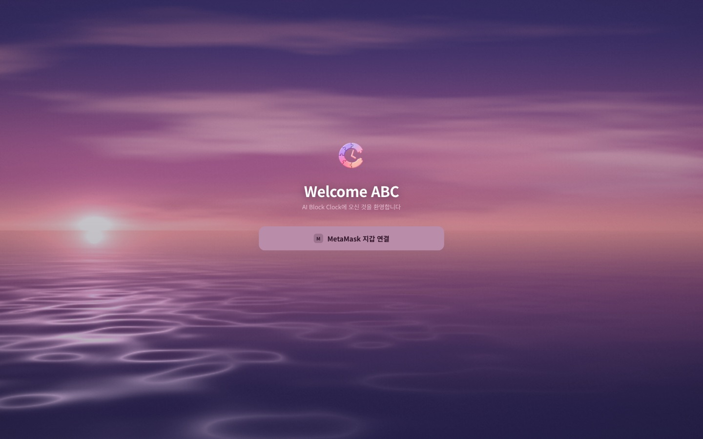
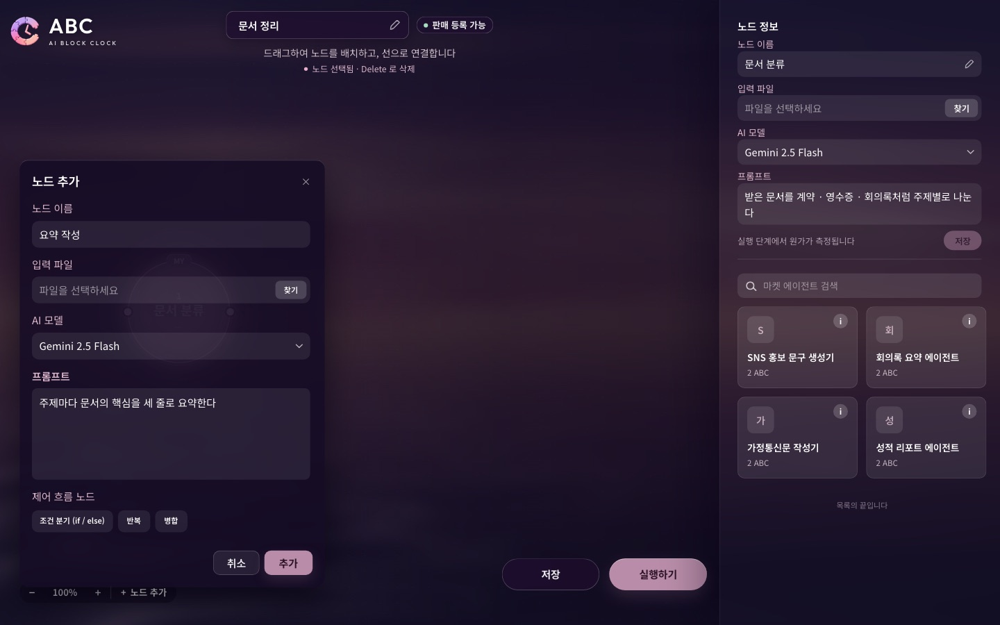
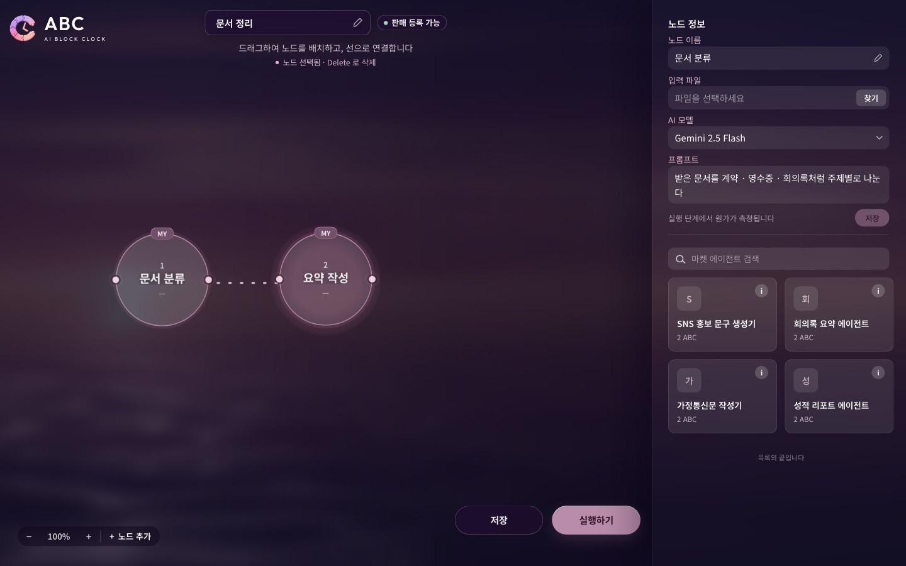
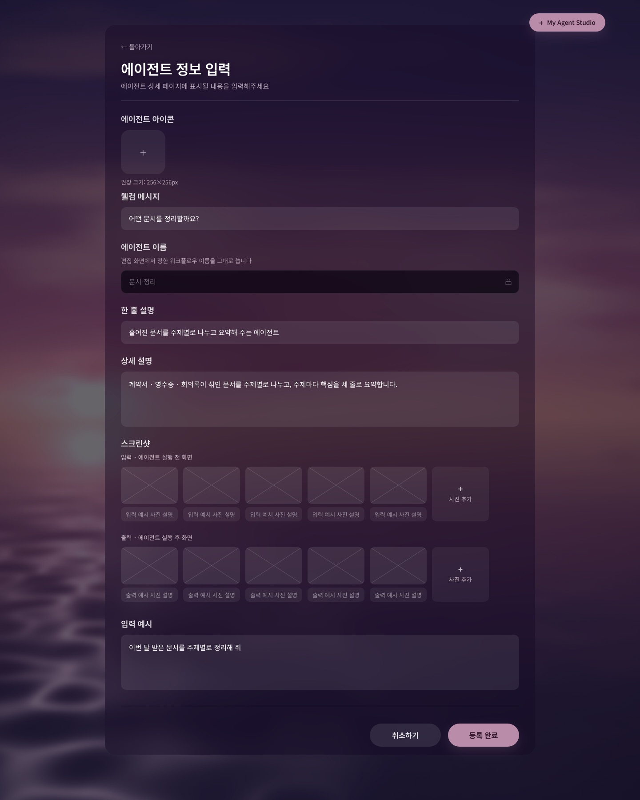
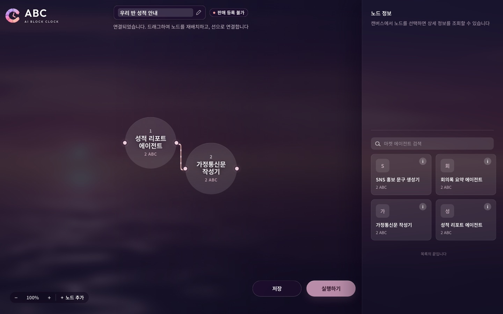
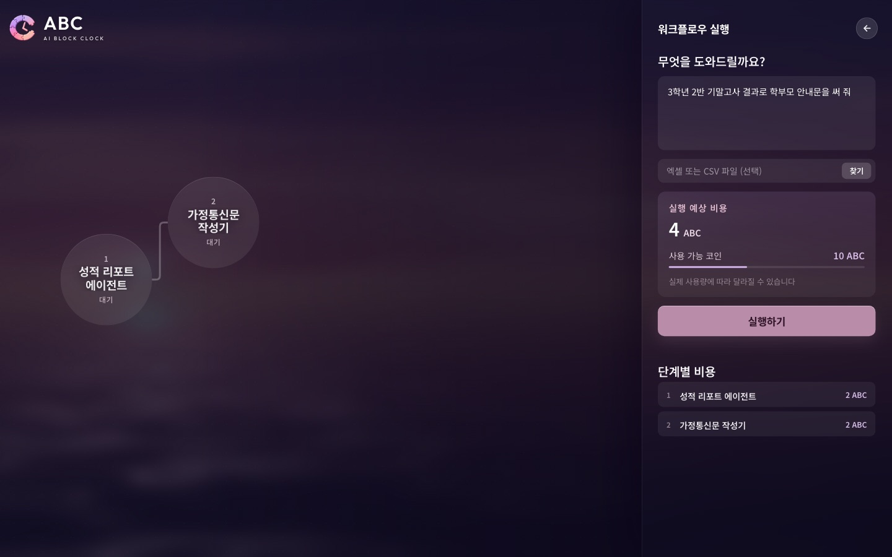
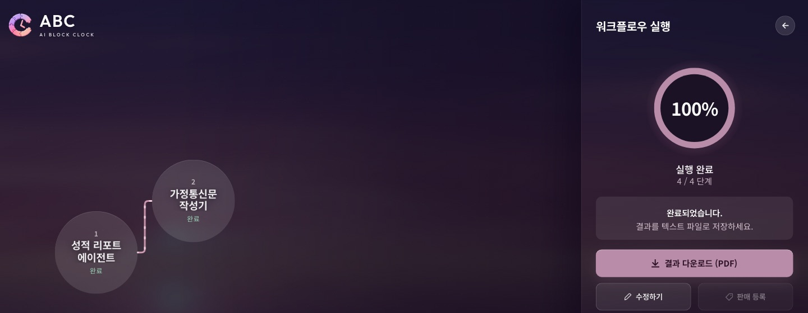
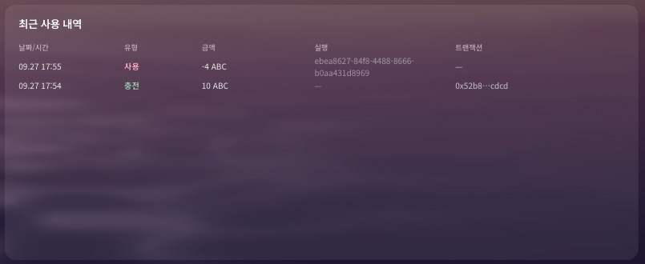
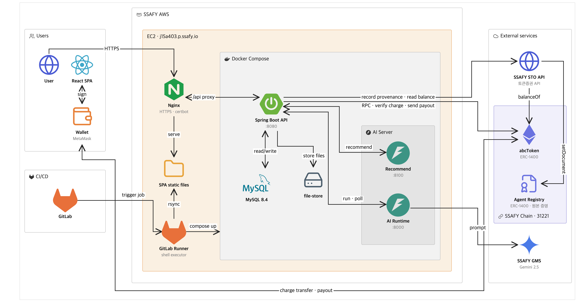

# ABC — AI Block Clock

AI 작업 블록을 만들어 파는 사람과, 그 블록을 이어 붙여 일을 맡기는 사람을 잇는 마켓플레이스입니다.
코드를 짜지 않아도 캔버스에 노드를 놓고 선으로 이으면 에이전트가 되고, 사람들이 그 에이전트를 쓸 때마다 만든 사람에게 정산금이 쌓입니다.
돈은 SSAFY 체인의 abcToken 을 충전해서 사용하고 출금할 수 있습니다.

**서비스 주소** · https://j15a403.p.ssafy.io


## 한눈에 보기

| 판매자는 | 구매자는 |
| --- | --- |
| 지갑으로 로그인하고, 프롬프트 · 모델 · 출력 형식을 정해 노드를 만든다 | 하고 싶은 일을 한 문장으로 적어 에이전트를 추천받는다 |
| 노드를 캔버스에서 잇고(분기 · 합류도 된다) 테스트 실행으로 원가를 잰다 | 고른 에이전트를 캔버스에서 이어 워크플로우로 저장한다 |
| 워크플로우를 굳혀 에이전트로 판매 등록한다. 프롬프트는 가려지고 원작자는 체인에 남는다 | MetaMask 로 abcToken 을 충전하고, 견적을 보고 실행한다 |
| 실행될 때마다 성공한 단계만큼 정산금을 받고, 본인 확인 뒤 abcToken 으로 출금한다 | 결과를 JSON · PDF 로 받는다. 안 간 분기와 실패한 단계는 돌려받는다 |

가격은 판매자가 정하지 않습니다. 플랫폼이 테스트 실행으로 잰 원가(Base Cost)에 에이전트 등급(Tier)의 할증을 붙여 정합니다.

## 화면으로 보는 흐름

### 판매자 — 노드를 이어 에이전트를 만들고 판다

| 지갑으로 로그인 | 가입 |
| --- | --- |
|  |  |
| MetaMask 서명 한 번으로 로그인한다. 비밀번호가 없다 | 이름과 한 줄 소개만 적으면 된다 |

| 노드 추가 | 캔버스에서 잇기 |
| --- | --- |
|  |  |
| 이름 · 프롬프트 · 모델을 정해 노드를 만든다 | 노드를 끌어다 놓고 선으로 잇는다. 오른쪽에서 남의 에이전트도 꺼내 쓸 수 있다 |

| 판매 등록 |
| --- |
|  |
| 에이전트 이름은 편집 화면의 워크플로우 이름을 그대로 쓴다. 한 줄 설명 · 상세 설명 · 입력 예시를 적어 마켓에 올리면 버전이 굳고 판매가가 매겨진다 |

### 구매자 — 충전하고, 추천받아 잇고, 실행한다

| abcToken 충전 |
| --- |
|  |
| MetaMask 로 abcToken 을 보관 지갑에 보내면, 서버가 체인에서 입금을 확인하고 ABC 를 적립한다(화면 이름은 「예치」) |

| 하고 싶은 일 적기 | 추천받아 고르기 |
| --- | --- |
|  |  |
| 자연어로 적으면 추천 엔진이 공개 에이전트를 찾아 준다 | 고른 순서대로 캔버스에 이어진다 |

| 워크플로우 저장 | 견적 확인 |
| --- | --- |
|  |  |
| 이어진 에이전트를 워크플로우로 저장한다 | 요청을 적으면 단계별 비용과 예상 비용, 충전해 둔 잔액이 나온다 |

| 실행 중 | 완료 |
| --- | --- |
|  |  |
| 단계마다 진행 상황이 실시간으로 올라온다 | 결과를 PDF 로 내려받는다 |

| 충전 · 사용 내역 |
| --- |
|  |
| 충전한 10 ABC 와 실행에 쓴 4 ABC 가 거래 해시 · 실행 번호와 함께 남는다 |


## 아키텍처



- **로그인**은 지갑 서명으로 하고 세션은 쿠키(Spring Session JDBC)로 잇습니다. 쓰기 요청은 CSRF 토큰을 붙입니다. 자세한 것은 [`SESSION_AUTH.md`](backend/ai-block-clock/docs/SESSION_AUTH.md).
- **실행**은 백엔드가 워크플로우를 엔진 계약의 JSON 으로 만들어 AI 런타임에 맡기고, 끝날 때까지 폴링합니다. 화면은 SSE 로 진행 상황을 받고, 끊기면 폴링으로 넘어갑니다.
- **돈**은 모두 백엔드 장부가 셉니다. 실행을 받을 때 견적만큼 먼저 떼고(선차감), 끝나면 성공한 단계만큼 판매자에게 정산하고 나머지를 돌려줍니다. 분기가 있으면 두 갈래를 다 더해 먼저 떼고, 안 간 갈래 몫은 돌려줍니다.
- **체인**에는 충전(사용자 → 보관 지갑), 출금 지급(보관 지갑 → 판매자), 에이전트 원본 증명(등기부 토큰)이 남습니다. 충전 확인과 출금 지급은 RPC 로 체인에 직접 붙고, 원본 증명은 SSAFY 토큰증권(STO) API 로 기록합니다. 가스비는 들지 않습니다.

## 기술 스택

| 영역 | 쓰는 것 |
| --- | --- |
| Frontend | React 19 · Vite 8 · TypeScript 6 · React Router 7 · TanStack Query 5 · Zustand 5 · Tailwind CSS 4 · wagmi 2 · viem 2 · MSW · Vitest (Node 24) |
| Backend | Java 25 · Spring Boot 4.1 · Spring Security · Spring Session JDBC · Spring Data JPA · Flyway · MySQL 8.4 (로컬은 H2) · web3j 6 · springdoc-openapi |
| AI Runtime | Python 3.11 · uv · FastAPI · google-genai (SSAFY GMS 경유 Gemini 2.5 Pro) · Jinja2 · xhtml2pdf |
| Recommend | Python 3.12 · FastAPI · sentence-transformers (`jhgan/ko-sroberta-multitask` 파인튜닝, 로컬은 사전학습 모델) |
| Blockchain | SSAFY 체인(chain id 31221) · abcToken (ERC-1400, 토큰증권 API) · 에이전트 등기부 토큰 |
| Infra | GitLab CI · Docker Compose · Nginx · EC2 |

## 저장소 구성

```
.
├── backend/ai-block-clock/   Spring 멀티 모듈 (core · storage · client · support) 과 docs/
├── frontend/                 React 앱
├── ai/
│   ├── spike/linear-mvp/     배포되는 AI 런타임 (실행 엔진)
│   ├── recommend/            자연어 에이전트 추천 서비스
│   └── docs/                 연동 계약 · 추천 API · 등급 수식
├── docs/                     서비스 흐름 · CI/CD
├── scripts/                  abcToken 발행 · 등기부 배포 같은 일회성 체인 스크립트
├── .githooks/                커밋 메시지 · pre-commit 훅
├── .gitlab/                  파트별 CI 설정 · MR 템플릿
├── GLOSSARY.md               용어집 (기획 용어 ↔ 코드 이름)
└── git-workflow.md           브랜치 · 커밋 · MR 규칙
```

## 실행

각 파트의 README 에 더 자세한 내용이 있습니다.

### Backend

```bash
cd backend/ai-block-clock
docker compose up -d --build        # MySQL + 백엔드 (dev 프로파일, :8080)
```

compose 는 AI 런타임과 추천 서비스를 컨테이너 이름으로 찾습니다. 아래처럼 AI 를 호스트에서 띄운다면 `backend/ai-block-clock/.env` 에 호스트 주소를 넣습니다. 리눅스 Docker 는 `host.docker.internal` 이 없으니 compose 의 백엔드 서비스에 `extra_hosts: ["host.docker.internal:host-gateway"]` 를 더합니다.

```bash
AI_RUNTIME_BASE_URL=http://host.docker.internal:8000
AI_RECOMMEND_BASE_URL=http://host.docker.internal:8100
```

Docker 없이 띄우면 기본 프로파일(`local`)이 인메모리 H2 로 뜹니다. API 문서는 `http://localhost:8080/api/swagger-ui.html` 에 있습니다.

```bash
./gradlew test               # 단위 테스트
./gradlew integrationTest    # @Tag("integration") 통합 테스트
./gradlew containerTest      # @Tag("container") 실제 MySQL 컨테이너 테스트
```

### Frontend

```bash
cd frontend
cp .env.example .env.local   # 실제 백엔드에 붙이려면 VITE_USE_MOCK=false
npm install
npm run dev                  # http://localhost:5173, /api 는 :8080 으로 넘긴다
```

`VITE_USE_MOCK` 을 비우거나 `true` 로 두면 MSW 목 응답으로 뜹니다.

### AI Runtime

```bash
cd ai/spike/linear-mvp
uv sync
cp .env.example .env         # LLM_API_KEY (GMS 팀 키) 를 채운다
uv run uvicorn src.api:app --host 0.0.0.0 --port 8000
```

### Recommend

```bash
cd ai/recommend
pip install -r requirements.txt httpx   # httpx 는 seed_index.py 가 쓴다
uvicorn app.main:app --reload --port 8100   # 터미널 1
python seed_index.py                        # 터미널 2, 서버가 뜬 뒤 시드 에이전트를 넣는다
```

파인튜닝한 가중치(`models/abc-agent-retriever-v1`)는 git 에 없어서, 로컬에서는 사전학습 모델 `jhgan/ko-sroberta-multitask` 로 뜹니다.

백엔드와 AI 서비스는 같은 서비스 토큰을 나눠 씁니다. 백엔드는 `AI_SERVICE_TOKEN`, AI 서비스는 `ABC_SERVICE_TOKEN` 에 같은 값을 넣고, 헤더 `X-ABC-Service-Token` 으로 주고받습니다.

## 개발 규칙

브랜치 · 커밋 · MR 규칙은 [`git-workflow.md`](git-workflow.md) 에 있습니다. 처음 한 번 `sh .githooks/install.sh` 로 훅을 켜면 커밋 메시지 형식을 검사합니다.

## 문서

| 문서 | 내용 |
| --- | --- |
| [`docs/service-flow.md`](docs/service-flow.md) | 판매자 · 구매자가 처음부터 끝까지 겪는 흐름 |
| [`GLOSSARY.md`](GLOSSARY.md) | 용어집. 기획 용어와 코드 이름을 짝지어 둔다 |
| [`backend/ai-block-clock/docs/`](backend/ai-block-clock/docs/README.md) | 백엔드 구조 · 모듈 · 규칙, 충전 · 출금 · 원본 증명 설계 |
| [`ai/docs/integration-guide.md`](ai/docs/integration-guide.md) | AI 런타임 연동 계약 — 요청 · 응답 · 정산 · 오류 |
| [`ai/docs/recommend-api.md`](ai/docs/recommend-api.md) | 추천 API |
| [`ai/docs/grading-formula.md`](ai/docs/grading-formula.md) | 에이전트 점수 · 등급 수식 |
| [`frontend/docs/frontend-conventions.md`](frontend/docs/frontend-conventions.md) | 프론트엔드 규칙 |
| [`docs/cicd.md`](docs/cicd.md) | 러너 · CI 잡 · 배포 · 환경 변수 |
