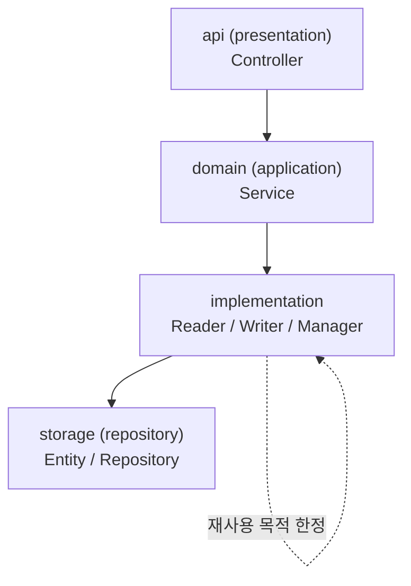

# 백엔드 아키텍처

본 문서는 계층 구조와 계층 간 의존 규칙을 정의한다. 코드 리뷰의 판단 기준이 된다.

- 계층별 책임을 고정해 특정 계층이 비대해지는 것을 막는다
- 의존 방향을 한 방향으로 고정해 변경의 파급 범위를 예측 가능하게 한다
- 유스케이스의 조회·검사·변경을 Service 트랜잭션으로 묶고 영속성 구현은 분리한다

---

## 1. 계층 구조

### 1.1 4계층

일반적인 3계층(presentation - application - repository)에 **implementation 계층**을 추가한 4계층 구조를 따른다.

| 계층 | 통칭 | 책임 | 대표 타입 |
| --- | --- | --- | --- |
| `api` | presentation | HTTP 요청·응답, 입력 검증, 직렬화 | `Controller`, `Request`, `Response` |
| `domain` | application | 유스케이스의 **흐름** 표현, 트랜잭션 경계 | `Service`, 도메인 모델 |
| `implementation` | - | 흐름을 이루는 **각 단계의 구현** | `Reader`, `Writer`, `Manager` 등 |
| `storage` | repository | 영속성, 외부 저장소 접근 | `Entity`, `Repository` |



### 1.2 implementation 계층을 두는 이유

3계층에서는 `Service` 하나가 유스케이스의 흐름, 영속성 호출, 엔티티 변환, 트랜잭션 경계를 모두 떠안는다. 기능이 늘수록 흐름이 구현 세부에 묻히고, 같은 변환 코드가 여러 `Service` 에 흩어진다.

implementation 계층은 영속성 호출과 엔티티 변환을 `Service` 밖으로 꺼낸다. 유스케이스 전체의 트랜잭션 경계는 `Service` 에 남긴다.

#### (1) 흐름이 읽힌다

구체적인 구현을 implementation 뒤로 숨기면, `Service` 에는 유스케이스의 순서만 남는다.

```java
// 3계층 — 흐름이 구현에 묻힌다
@Service
@RequiredArgsConstructor
public class MemberRegisterService {

    private final MemberRepository memberRepository;
    private final MailSender mailSender;

    @Transactional
    public Member register(MemberRegisterCommand command) {
        if (memberRepository.existsByEmail(command.email())) {   // 구현 세부
            throw new DuplicatedEmailException(command.email());
        }
        MemberEntity entity = MemberEntity.from(command);        // 변환
        MemberEntity saved = memberRepository.save(entity);      // 구현 세부
        Member member = saved.toDomain();                        // 변환
        mailSender.send(member.email(), WELCOME_TEMPLATE);       // 구현 세부
        return member;
    }
}
```

```java
// 4계층 — 무엇을 하는지가 그대로 읽힌다
@Service
@RequiredArgsConstructor
public class MemberRegisterService {

    private final MemberValidator memberValidator;
    private final MemberWriter memberWriter;
    private final MemberNotifier memberNotifier;

    public Member register(MemberRegisterCommand command) {
        memberValidator.checkNotDuplicated(command.email());
        Member member = memberWriter.append(command);
        memberNotifier.sendWelcome(member);
        return member;
    }
}
```

`Service` 만 읽어도 유스케이스를 파악할 수 있고, 세부가 궁금하면 해당 implementation 만 열어보면 된다.

#### (2) 유스케이스의 트랜잭션 경계가 읽힌다

조회·검사·변경을 함께 처리해야 하는 유스케이스는 `Service` 메서드에 `@Transactional` 을 선언한다. 트랜잭션을 열기 위한 위임 전용 `Manager` 를 추가하지 않는다. `Reader`·`Writer` 는 영속성과 변환을 담당하고 기본 전파 설정에서는 Service의 트랜잭션에 참여한다. 외부 API 호출·메일·알림 발송은 이 트랜잭션 밖에서 수행한다.

자세한 규칙은 4장에 정리한다.

#### (3) entity ↔ domain 변환이 한 곳에 모인다

변환 코드를 `Service` 마다 반복하지 않고, implementation 객체 하나에 두고 재사용한다. 엔티티는 `storage` 밖으로 나가지 않고, `Service` 는 도메인 모델만 다룬다.

---

## 2. 계층별 책임

### 2.1 `api` (presentation)

| 한다 | 하지 않는다 |
| --- | --- |
| HTTP 요청·응답 매핑 | 비즈니스 규칙 판단 |
| 요청 값 형식 검증 (`@Valid`) | 트랜잭션 관리 |
| 요청 DTO → Command 변환 | implementation·storage 직접 호출 |
| 도메인 모델 → 응답 DTO 변환 | 엔티티를 응답으로 노출 |
| 여러 `Service` 의 호출 순서 조립 | 호출 결과에 대한 비즈니스 판단 |

- 엔티티를 그대로 응답하지 않는다. 저장소 스키마 변경이 API 스펙 변경으로 새어나간다
- 예외는 `@RestControllerAdvice` 한 곳에서 응답으로 변환한다
~~~~
#### 여러 `Service` 의 조립

하나의 요청이 여러 도메인에 걸칠 때, 이를 묶는 Facade 나 조립 전용 `Service` 를 **만들지 않는다**. `Controller` 가 `Service` 들을 순서대로 호출하고 결과를 넘긴다.

```java
@PostMapping("/payments")
public PaymentResponse pay(@RequestBody @Valid PaymentRequest request) {
    Member member = memberService.get(request.memberId());
    Payment payment = paymentService.pay(member, request.toCommand());
    return PaymentResponse.from(payment);
}
```

여기서 `Controller` 가 제어하는 것은 **호출 순서와 데이터 전달**뿐이다. 조건 분기, 계산, 규칙 판단은 `Controller` 에 오지 않는다.

```java
// ❌ 비즈니스 판단이 Controller 에 들어왔다
Member member = memberService.get(request.memberId());
if (member.grade() == Grade.VIP && request.amount() > THRESHOLD) {   // 규칙
    discount = request.amount() * VIP_RATE;                          // 계산
}
```

조립 전용 클래스를 두지 않는 이유는 다음과 같다.

- 계층이 하나 더 늘어난다. `Controller` 도 `Service` 도 아닌 층이 생기고, 어느 로직을 어디 둘지 매번 판단해야 한다
- 그 클래스 안에 흐름과 규칙이 섞여 들어간다. `Service` 를 얇게 유지하려고 만든 계층이 결국 두꺼워진다
- `Controller` 가 이미 요청 단위의 조립 지점이다. 같은 일을 하는 자리를 둘 만들 이유가 없다

여러 도메인의 **쓰기를 한 트랜잭션으로 묶어야 한다면** 그것은 조립이 아니라 하나의 유스케이스다. `Service` 하나가 양쪽 도메인의 implementation 을 호출하고 트랜잭션 경계도 선언한다 (4장).

### 2.2 `domain` (application)

| 한다 | 하지 않는다 |
| --- | --- |
| 유스케이스의 흐름 정의 | 영속성 API 직접 호출 |
| implementation 호출 순서 결정, 트랜잭션 경계 선언 | HTTP·요청 컨텍스트 참조 |
| 도메인 모델 정의 | 엔티티 참조 |
| | 다른 `Service` 호출 |

- `Service` 의 메서드 하나가 유스케이스 하나에 대응한다
- 메서드 본문이 길어지면 흐름이 아니라 구현이 들어온 것이다. implementation 으로 옮긴다
- 도메인 모델은 엔티티와 분리된 순수 객체다. JPA 애노테이션을 갖지 않는다
- 다른 `Service` 를 호출하지 않는다. 여러 도메인에 걸친 요청은 `Controller` 가 조립한다 (2.1)

### 2.3 `implementation`

| 한다 | 하지 않는다 |
| --- | --- |
| 흐름 한 단계의 구체적 구현 | 유스케이스 전체 흐름 조립 |
| 재사용되는 단계의 트랜잭션 선언 | HTTP·요청 컨텍스트 참조 |
| entity ↔ domain 변환 | 응답 DTO 생성 |
| 저장소·외부 시스템 호출 | |

이름으로 역할을 드러낸다.

| 접미사 | 역할 |
| --- | --- |
| `Reader` | 조회 |
| `Writer` | 저장·수정·삭제 |
| `Validator` | 검증 |
| `Manager` | 여러 유스케이스에서 재사용하는 복합 단계 구현 |
| `Notifier`, `Sender` 등 | 외부 시스템 연동 |

### 2.4 `storage` (repository)

| 한다 | 하지 않는다 |
| --- | --- |
| 엔티티 정의, 매핑 | 비즈니스 규칙 판단 |
| 저장소 접근 (`Repository`) | 도메인 모델 참조 |
| 쿼리 작성 | 트랜잭션 경계 선언 |

- 엔티티는 이 계층 밖으로 나가지 않는다
- 스키마 변경은 Flyway 마이그레이션으로만 한다 (MODULES.md 3.3)

---

## 3. 의존 규칙

### 3.1 규칙

1. **단방향 하향** — 의존은 항상 위에서 아래로 흐른다
2. **역방향 금지** — 아래 계층이 위 계층을 의존하지 않는다
3. **인접 계층만** — 두 계층을 한 번에 건너뛰지 않는다
4. **같은 계층 순환 금지** — 같은 계층 안에서 서로를 의존하는 구조를 만들지 않는다
5. **예외: implementation 간 의존 허용** — 3.3 참고

| 출발 | 대상 | 허용 | 비고 |
| --- | --- | --- | --- |
| `api` | `domain` | ✅ | |
| `api` | `implementation` | ❌ | 2계층 건너뜀 |
| `api` | `storage` | ❌ | 3계층 건너뜀 |
| `domain` | `domain` | ❌ | `Service` 간 직접 호출 금지. 조립은 `api` 가 한다 (2.1) |
| `domain` | `implementation` | ✅ | |
| `domain` | `storage` | ❌ | 2계층 건너뜀 |
| `implementation` | `storage` | ✅ | |
| `implementation` | `implementation` | ⚠️ | 재사용 목적에 한해 허용, 순환 금지 |
| 아래 → 위 | 전부 | ❌ | 역방향 |

### 3.2 건너뛰기를 금지하는 이유

간단한 조회라도 `Controller` 가 `Repository` 를 직접 부르는 순간, 그 유스케이스는 `Service` 를 읽어도 파악되지 않는다. 예외를 한 번 허용하면 "이건 단순하니까" 가 반복되고 계층 구분이 사실상 사라진다.

기능이 단순해서 `Service` 가 implementation 을 한 줄 호출하고 끝나더라도 계층을 생략하지 않는다.

```java
// ❌ Controller 가 Repository 를 직접 호출
@GetMapping("/members/{id}")
public MemberResponse get(@PathVariable Long id) {
    return MemberResponse.from(memberRepository.findById(id).orElseThrow());
}

// ❌ Service 가 Repository 를 직접 호출
public Member get(Long id) {
    return memberRepository.findById(id).orElseThrow().toDomain();
}

// ✅
public Member get(Long id) {
    return memberReader.read(id);
}
```

### 3.3 implementation 간 의존을 허용하는 이유

**재사용성** 때문이다. 이 예외는 재사용을 위한 것이지, 편의를 위한 것이 아니다.

같은 조회·저장 로직이 여러 유스케이스에 필요할 때, 각 implementation 이 같은 코드를 복사하는 대신 이미 있는 implementation 을 가져다 쓴다. 여러 유스케이스에서 같은 복합 단계가 필요할 때만 `Manager` 가 기존 `Writer` 들을 조합한다. 단일 유스케이스의 전체 순서는 Service에 둔다.

```java
@Component
@RequiredArgsConstructor
public class MemberWithdrawManager {

    private final MemberWriter memberWriter;      // 재사용
    private final PointWriter pointWriter;        // 재사용

    @Transactional
    public void withdraw(Long memberId) {
        memberWriter.deactivate(memberId);
        pointWriter.expireAll(memberId);
    }
}
```

허용에는 조건이 붙는다.

- **순환 금지** — `A → B → A` 는 어떤 경우에도 금지한다. 규칙 4는 이 예외 안에서도 유효하다
- **흐름을 넣지 않는다** — implementation 이 다른 implementation 을 여럿 부르며 분기까지 하고 있다면 그건 유스케이스다. `Service` 로 올린다
- **트랜잭션 중첩 확인** — 호출된 implementation 의 `@Transactional` 은 기본 전파 설정에서 호출자의 트랜잭션에 참여한다. 별도 트랜잭션이 필요하면 명시한다
- **재사용이 아니면 나누지 않는다** — 호출하는 쪽이 하나뿐이라면 굳이 분리하지 말고 합친다

### 3.4 도메인 모델의 취급

의존 규칙은 **컴포넌트 간 호출 방향**에 적용한다. 도메인 모델은 계층 사이를 오가는 값이므로 예외로 둔다.

- `implementation` 이 `domain` 계층의 도메인 모델을 반환하는 것은 역방향 의존으로 보지 않는다
- 단, `implementation` 이 `Service` 를 호출하는 것은 명백한 역방향이며 금지한다
- 엔티티에는 이 예외가 적용되지 않는다. 엔티티는 `storage` 밖으로 나가지 않는다

---

## 4. 트랜잭션

### 4.1 경계

**유스케이스의 트랜잭션 경계는 `Service` 에 선언한다.** implementation은 독립적으로 사용하는 단계에 트랜잭션을 선언할 수 있으며, 기본 전파 설정에서는 Service의 트랜잭션에 참여한다.

| 계층 | `@Transactional` |
| --- | --- |
| `api` | ❌ |
| `domain` | ✅ |
| `implementation` | ✅ |
| `storage` | ❌ |

### 4.2 규칙

- 조회만 하는 경우 `@Transactional(readOnly = true)` 를 쓴다
- 외부 API 호출, 메일·알림 발송은 트랜잭션 안에 넣지 않는다. 응답이 늦어지면 커넥션을 점유한 채로 대기하게 된다
- 유스케이스에서 함께 성공·실패해야 하는 조회·검사·변경은 Service 메서드 하나의 트랜잭션으로 묶는다
- 트랜잭션을 열기 위해서만 위임하는 Manager를 만들지 않는다. 재사용되는 복합 단계만 분리한다
- 트랜잭션만으로 동시 요청이 직렬화되지는 않는다. 필요한 행 잠금·조건부 UPDATE는 유지한다
- 잠금 대기나 연산 중 만료될 수 있으므로 상태 검사와 쓰기 시점의 만료 조건을 구분한다

---

## 5. 계층과 모듈

계층은 개념이고 모듈은 물리 구조다. 둘이 1:1 일 필요는 없지만, 모듈 경계로 나누면 의존 규칙 위반이 컴파일 단계에서 걸린다.

| 계층 | 패키지 | 모듈 | 현재 상태 |
| --- | --- | --- | --- |
| `api` | `com.aiblockclock.api` | `:core:core-api` | 생성됨 |
| `domain` | `com.aiblockclock.domain` | 미정 | **미생성** |
| `implementation` | `com.aiblockclock.domain.{도메인}` | `:core:core-api` | 생성됨 — **도메인 패키지 안에 함께 둔다** |
| `storage` | `com.aiblockclock.storage` | `:storage` | 생성됨 |
| (계층 아님) | `com.aiblockclock.support` | `:core:core-api` | 생성됨 — 계층을 가로지르는 공통 코드 |

`domain` 과 `implementation` 계층을 담을 모듈은 아직 정하지 않았다. 결정 전까지 이 문서의 규칙은 패키지 단위로 적용한다.

**공통 헬퍼는 `com.aiblockclock.support` 에 둔다.** 특정 도메인에 속하지 않고 계층을 가로지르는 코드
(`ApiResult`, `ErrorType`, `CursorPage`, `OffsetCursor`) 의 자리다. `api` 패키지에 두면 api 계층 전용처럼
보여서 implementation 계층이 쓰기를 망설이게 되고, 도메인 패키지에 두면 `WorkflowPage` · `AgentPage` 처럼
같은 모양이 도메인마다 복제된다. 도메인 이름이 붙지 않는 헬퍼라면 `support` 다.

`storage` 안에서만 쓰는 영속성 헬퍼(`OffsetPageable`)는 예외로 `com.aiblockclock.storage.support` 에 둔다.
`storage` 는 `core-api` 를 의존할 수 없어서(MODULES.md 2.3 역방향 금지) 위쪽 `support` 를 쓸 수 없다.

**`implementation` 은 자기 패키지를 갖지 않는다.** 계층은 개념이므로 패키지와 1:1 일 필요가 없고,
`WorkflowReader` 는 워크플로우를 읽는 코드이므로 `Workflow` 옆에 있는 것이 찾기 쉽다.
계층은 패키지가 아니라 **접미사로 판별한다** (NAMING.md 2.3). 그래서 리뷰 항목도
"`domain` 패키지가 엔티티를 참조하는가" 가 아니라 "`Service` 가 엔티티를 참조하는가" 다 (6장).

> **미해결**: 현재 `:core:core-api` 가 `:storage` 를 직접 의존하고 있다. 규칙 3(인접 계층만) 위반이므로, `domain` · `implementation` 모듈이 생기면 이 의존을 끊고 `api → domain → implementation → storage` 로 연결해야 한다.
>
> 같은 이유로 **엔티티와 `JpaRepository` 가 `storage` 밖으로 나가 있다.** `WorkflowReader` · `WorkflowWriter` 가
> `WorkflowRepository` 를 직접 주입받고 `WorkflowEntity` 를 다룬다. `storage` 는 이를 위해 JPA 를 `api` 로 노출한다
> (MODULES.md 2.2). 도메인 모델이 별도 모듈로 나가면 리포지토리 인터페이스를 그쪽에 두고 `storage` 가 구현하도록 바꾼다.
> 그 전까지 6장의 "엔티티가 `storage` 밖으로 나가지 않는가" 는 implementation 계층에 한해 유예한다 —
> **`Service` 와 `Controller` 에는 그대로 적용된다.**

---

## 6. 리뷰 체크리스트

- [ ] `Controller` 가 `Service` 외의 계층을 호출하지 않는가
- [ ] `Service` 메서드가 유스케이스의 흐름으로 읽히는가
- [ ] `Service` 가 `Repository` 나 엔티티를 참조하지 않는가
- [ ] 함께 성공·실패해야 하는 조회·검사·변경이 Service의 트랜잭션 안에 있는가
- [ ] 트랜잭션 위임만 하는 Manager나 불필요한 중복 조회·검사가 없는가
- [ ] 필요한 잠금·조건부 UPDATE·실패 시 전체 롤백을 테스트했는가
- [ ] 트랜잭션 안에 외부 시스템 호출이 들어가 있지 않은가
- [ ] 엔티티가 `storage` 밖으로 나가지 않는가
- [ ] implementation 간 의존이 재사용을 위한 것인가, 순환은 없는가
- [ ] `Service` 가 다른 `Service` 를 호출하지 않는가
- [ ] 여러 도메인에 걸친 요청을 Facade 가 아니라 `Controller` 가 조립하는가
- [ ] `Controller` 의 조립이 호출 순서와 데이터 전달에 그치는가
