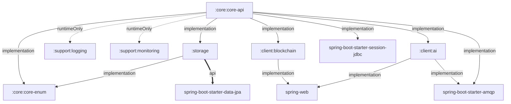

# 백엔드 모듈 구조

본 문서는 Gradle 멀티모듈 구성과 **모듈 간 의존 관계**를 정의한다.

- 코드를 어느 모듈에 둘지 판단 기준을 통일한다
- 의존 방향을 고정해 모듈 간 순환 참조를 막는다
- 설정과 의존성을 모듈 단위로 가두어 책임 경계를 유지한다
- 모듈을 추가·분리할 때 따라야 할 절차를 남긴다

---

## 1. 모듈 구성

### 1.1 전체 트리

```
backend/ai-block-clock/
├── settings.gradle          모듈 등록
├── build.gradle             leaf 모듈 공통 설정
├── core/                    wrapper
│   ├── core-api/            실행 모듈 (진입점) — application.yaml
│   └── core-enum/           공통 enum
├── storage/                 영속성 — db.yml, db/migration
├── support/                 wrapper
│   ├── logging/             로깅 — logback-spring.xml
│   └── monitoring/          모니터링 — monitoring.yml
└── client/                  wrapper
    ├── blockchain/          SSAFY 토큰증권 API · 체인 RPC 연동 — blockchain.yml
    └── ai/                  AI 파트 서비스 연동 (추천 · 실행 엔진) — ai.yml
```

각 모듈은 자기 관심사의 설정 파일을 직접 소유한다 (4장).

운영자가 손으로 실행하는 일회성 온체인 작업(토큰 발행 등)은 모듈이 아니라 저장소 루트의 `scripts/` 에 스크립트로 둔다. 빌드 산출물에 들어가지 않으므로 서버 기동 경로에서 실행될 수 없다.

### 1.2 모듈 종류

모듈은 두 종류로 나뉜다.

| 종류 | 설명 | 해당 모듈 |
| --- | --- | --- |
| wrapper | 하위 모듈만 묶는 상자. 소스도 `build.gradle` 도 갖지 않는다 | `:core`, `:support`, `:client` |
| leaf | 실제 소스·리소스를 갖는 모듈. 빌드 산출물이 나온다 | 그 외 전부 |

루트 `build.gradle` 의 공통 설정은 leaf 모듈에만 적용된다. wrapper 는 Java 플러그인조차 적용되지 않으므로 빈 jar 이 생기지 않는다.

```groovy
// 하위 모듈을 가진 프로젝트(= wrapper)는 설정 대상에서 제외된다
configure(subprojects.findAll { it.subprojects.isEmpty() }) { ... }
```

### 1.3 모듈 목록

| 모듈 | 종류 | 역할 | 산출물 |
| --- | --- | --- | --- |
| `:core` | wrapper | `core-api`, `core-enum` 을 묶는다 | 없음 |
| `:core:core-api` | leaf | 애플리케이션 진입점, 웹 계층 | `bootJar` (실행 가능) |
| `:core:core-enum` | leaf | 모듈 공통 enum | jar |
| `:storage` | leaf | 영속성 (JPA, 마이그레이션) | jar |
| `:support` | wrapper | `logging`, `monitoring` 을 묶는다 | 없음 |
| `:support:logging` | leaf | 프로파일별 logback 설정 | jar (리소스만) |
| `:support:monitoring` | leaf | 액추에이터·메트릭 설정 | jar |
| `:client` | wrapper | 외부 시스템 연동 모듈을 묶는다 | 없음 |
| `:client:blockchain` | leaf | SSAFY 토큰증권 API · 체인 RPC 연동 (조회 + 출금 전송 서명 · 보내기) | jar |
| `:client:ai` | leaf | AI 파트 서비스 연동 (추천 엔진 · 실행 엔진 — 실행 메시지는 RabbitMQ) | jar |

그룹·버전은 전 모듈 공통으로 `com.aiblockclock:0.0.1-SNAPSHOT` 이다.

---

## 2. 모듈 간 의존 관계

### 2.1 의존 그래프



의존은 **항상 한 방향**이다. `core-api` 는 모든 모듈을 알고, `core-enum` 은 아무도 모른다.

### 2.2 의존성 선언

| 모듈 | 의존 대상 | configuration | 이유 |
| --- | --- | --- | --- |
| `:core:core-api` | `:storage` | `implementation` | 영속성 계층을 호출한다 |
| `:core:core-api` | `spring-tx` | `implementation` | Service가 유스케이스 트랜잭션 경계를 잡고 implementation은 이에 참여한다 |
| `:core:core-api` | `spring-boot-starter-session-jdbc` | `implementation` | HttpSession을 기존 MySQL에 저장하고 여러 요청에서 인증 상태를 복원한다 |
| `:core:core-api` | `:core:core-enum` | `implementation` | 공통 enum 을 참조한다 |
| `:core:core-api` | `:client:blockchain` | `implementation` | 온체인 상태를 조회한다 |
| `:core:core-api` | `:client:ai` | `implementation` | 추천 색인을 유지하고 추천을 중계한다. 실행을 브로커로 맡기고 이벤트로 따라간다 |
| `:core:core-api` | `spring-boot-starter-amqp` | `implementation` | 실행 이벤트 · dead letter 리스너(`@RabbitListener`)가 api 계층(`api/messaging`)에 있다. 발행자는 `:client:ai` 에 있다 |
| `:core:core-api` | `:support:logging` | `runtimeOnly` | 설정 리소스만 클래스패스에 올린다 |
| `:core:core-api` | `:support:monitoring` | `runtimeOnly` | 설정 리소스만 클래스패스에 올린다 |
| `:storage` | `:core:core-enum` | `implementation` | 엔티티에서 공통 enum 을 쓴다 |
| `:storage` | `spring-boot-starter-data-jpa` | `api` | implementation 계층이 `JpaRepository` 와 `Pageable` 을 직접 다룬다 (3.3 참고) |
| `:core:core-enum` | 없음 | - | 외부 라이브러리도 추가하지 않는다 |
| `:support:logging` | 없음 | - | 리소스만 갖는다 |
| `:support:monitoring` | 없음 (프로젝트 기준) | - | 액추에이터 라이브러리만 갖는다 |
| `:client:blockchain` | `spring-web` | `implementation` | `RestClient` 를 직접 선언한다. `core-api` 의 웹 스타터에 얹히지 않는다. 응답이 스칼라라 JSON 변환기는 두지 않는다 |
| `:client:ai` | `spring-web`, `spring-boot-starter-json` | `implementation` | `RestClient` 를 직접 선언한다. 요청·응답이 객체라 JSON 변환기(Jackson)를 둔다 |
| `:client:ai` | `spring-boot-starter-amqp` | `implementation` | 실행 접수 · 진행 · 완료 · 취소를 RabbitMQ 로 주고받는다(ADR-0001). 발행자(`RunQueuePublisher`) · 토폴로지 · 메시지 모양이 여기 있다 |

`support:*` 를 `runtimeOnly` 로 붙이는 이유는, 이 모듈들이 **설정만 제공**하고 애플리케이션 코드가 이들의 클래스를 직접 참조할 일이 없기 때문이다. `implementation` 으로 붙이면 컴파일 의존이 생겨 나중에 지우기 어려워진다.

### 2.3 의존 규칙

지켜야 할 규칙은 다음과 같다.

1. **역방향 금지** — `storage` · `support:*` · `client:*` 가 `core-api` 를 의존해서는 안 된다
2. **형제 모듈 금지** — `storage` · `support:*` · `client:*` 는 서로 의존하지 않는다
3. **`core-enum` 은 순수하게 유지** — 어떤 모듈도, 어떤 외부 라이브러리도 의존하지 않는다. 다른 모듈이 공유해야 하는 enum 만 둔다
4. **wrapper 에 직접 의존 금지** — `project(':support')` 가 아니라 `project(':support:logging')` 처럼 leaf 를 지정한다
5. **Spring Boot 플러그인은 `core-api` 에만** — 실행 가능한 산출물은 하나뿐이다. 나머지 모듈은 일반 라이브러리 jar 로 남는다
6. **설정도 모듈에 가둔다** — 특정 모듈에서만 쓰는 설정을 `core-api` 의 `application.yaml` 에 적지 않는다 (4장)

---

## 3. 모듈별 상세

### 3.1 `:core:core-api`

애플리케이션 진입점이자 웹 계층을 담당한다. 유일하게 실행 가능한 모듈이다.

```
core/core-api/src/main/
├── java/com/aiblockclock/
│   ├── AiBlockClockApplication.java   진입점
│   └── api/                           컨트롤러, 요청·응답 DTO
└── resources/application.yaml
```

- 진입점 클래스는 베이스 패키지 `com.aiblockclock` 에 둔다. 컴포넌트 스캔이 다른 모듈의 `com.aiblockclock.*` 패키지까지 닿아야 하기 때문이다
- `core-api` 자체 코드는 `com.aiblockclock.api` 아래에 둔다
- 의존성: `spring-boot-starter-webmvc`, `spring-boot-starter-validation`,
  `spring-boot-starter-security`, `spring-boot-starter-session-jdbc`, `spring-boot-starter-amqp`
- `application.yaml` 에는 **애플리케이션 조립**(이름, 기본 프로파일, `config.import`)과 `core-api` 자신의 설정(`server.*`)만 둔다. 다른 모듈의 설정을 여기에 적지 않는다
- `bootJar` 활성화, 일반 `jar` 비활성화

### 3.2 `:core:core-enum`

여러 모듈이 공유하는 enum 만 둔다. 패키지는 `com.aiblockclock.enums` 다. (`enum` 은 예약어라 패키지명으로 쓸 수 없다.)

- 외부 라이브러리를 추가하지 않는다. 여기에 의존성이 생기면 그 의존성이 전 모듈로 퍼진다
- 한 모듈에서만 쓰는 enum 은 해당 모듈에 둔다

### 3.3 `:storage`

영속성 계층이다. 패키지는 `com.aiblockclock.storage` 다. **DB 설정을 이 모듈이 소유한다.**

```
storage/src/main/resources/
├── db.yml            공통 (JPA, Flyway)
├── db-local.yml
├── db-dev.yml
├── db-prod.yml
└── db/migration/     Flyway 마이그레이션 스크립트
```

- JPA 엔티티, 리포지토리, 마이그레이션 스크립트를 둔다
- **JPA 를 `api` 로 노출한다.** implementation 계층(`Reader`/`Writer`)이 `JpaRepository` 를 직접 주입받고
  `Pageable` 을 직접 조립한다. 엔티티도 이미 `storage` 밖으로 나가고 있으므로, Spring Data 타입만 가리는
  래퍼 클래스를 두는 것은 값을 못 한다 — 감추려면 엔티티까지 감춰야 하고, 그것은 `domain` 모듈이 생길 때 한다
  (ARCHITECTURE.md 5장 미해결 항목)
- 의존성: `spring-boot-starter-data-jpa`, `spring-boot-starter-flyway`, `flyway-mysql`, 드라이버(`mysql-connector-j`, `h2`)
- 시각 컬럼은 **`Instant`** 로 매핑한다. 생성·수정 시각은 `audit/BaseCreatedAtEntity`,
  `audit/BaseTimeEntity` 를 상속해 JPA Auditing 이 채우고, 엔티티가 직접 필드를 갖지 않는다.
  `LocalDateTime` 은 오프셋이 없어 API 응답과 DB 사이에서 타임존이 유실되므로 쓰지 않는다
- `ddl-auto` 는 전 프로파일 `validate` 다. 스키마 변경은 마이그레이션 스크립트로만 한다
- `open-in-view` 는 끈다. 영속성 컨텍스트가 웹 계층까지 열려 있으면 모듈 경계가 무너진다

| 프로파일 | 데이터소스 | 비고 |
| --- | --- | --- |
| `local` | 인메모리 H2 (MySQL 모드) | 별도 DB 설치 불필요, `show-sql` 활성 |
| `dev` | `${DB_URL}` 등 환경 변수 | 풀 크기 기본 10 |
| `prod` | `${DB_URL}` 등 환경 변수 | 풀 크기 기본 20, 기본값 없음 |

`dev` · `prod` 의 접속 정보는 `DB_URL`, `DB_USERNAME`, `DB_PASSWORD` 환경 변수로 주입한다. 기본값을 두지 않아 값이 없으면 기동 단계에서 실패한다. 자격 증명은 저장소에 두지 않는다.

### 3.4 `:support:logging`

프로파일별 logback 설정만 갖는다. 자바 소스가 없다.

```
support/logging/src/main/resources/
├── logback-spring.xml           공통 + 프로파일 분기
└── logback/
    ├── logback-local.xml
    ├── logback-dev.xml
    └── logback-prod.xml
```

세 프로파일 모두 **stdout 으로만** 출력한다. 로그 수집은 배포 환경의 수집기가 담당하므로 파일 appender 를 쓰지 않는다.

| 프로파일 | 포맷 | 레벨 |
| --- | --- | --- |
| `local` | 평문 (색상) | `com.aiblockclock`=DEBUG, root=INFO |
| `dev` | 평문 | `com.aiblockclock`=DEBUG, root=INFO |
| `prod` | 구조화 JSON (ECS) | INFO |

`prod` 의 출력 형식은 `logback-prod.xml` 의 `CONSOLE_LOG_STRUCTURED_FORMAT` 값으로 바꾼다 (`ecs` / `logstash` / `gelf`).

### 3.5 `:support:monitoring`

액추에이터·메트릭 설정을 갖는다.

```
support/monitoring/src/main/resources/
├── monitoring.yml           공통
├── monitoring-local.yml
├── monitoring-dev.yml
└── monitoring-prod.yml
```

- 의존성: `spring-boot-starter-actuator`, `micrometer-registry-prometheus`
- 노출 엔드포인트는 프로파일별로 다르다. `local` 은 전체(`*`), `prod` 는 `health`, `info`, `prometheus` 만 연다
- `health` 에 RabbitMQ 를 넣지 않는다(`management.health.rabbit.enabled: false`). 브로커가 죽어도 실행 접수는
  outbox 에 쌓이므로 백엔드는 UP 이다. 브로커는 자기 컨테이너 헬스체크로 본다 (ADR-0001)
- 이 파일들은 자동으로 읽히지 않는다. `core-api` 의 `application.yaml` 이 명시적으로 가져온다

```yaml
spring:
  config:
    import:
      - classpath:monitoring.yml   # monitoring-{profile}.yml 은 함께 로드된다
```

### 3.6 `:client:blockchain`

SSAFY 체인에 붙는 어댑터다. 패키지는 `com.aiblockclock.client.blockchain` 이고, **접속 설정을 이 모듈이 소유한다.**
창구가 둘이고, 서명은 따로 한 곳에서 한다.

| 창구 | 클래스 | 무엇을 하나 |
| --- | --- | --- |
| 토큰증권 API (`sto.ssafy.io`) | `SsafyStoClient` | 토큰 정보 · 잔액 · 총공급량 · 민터 권한 · 발행 가능 상태를 읽는다 |
| 토큰증권 API (`sto.ssafy.io`) | `SsafyStoDocumentClient` | 에이전트 등기부 토큰의 문서 칸을 등기부 지갑으로 서명해 쓰고 읽는다 ([agent-provenance.md](agent-provenance.md)) |
| 체인 노드 JSON-RPC (`rpc.ssafy-blockchain.com`) | `SsafyChainClient` | 거래 해시 하나의 상태 · 블록 번호 · 토큰 전송 로그를 읽는다(토큰증권 API 에 없어서 따로 둔다, [abc-charge.md](abc-charge.md) 2장). 출금 지급에 쓸 다음 거래 번호 · 가스를 재고, 서명된 거래를 보낸다 |
| (네트워크 없음) | `SsafyChainSigner` | 보관 지갑 키(`ssafy.chain.signer.private-key`)로 abcToken `transfer` 에 서명한다. 키는 이 클래스 밖으로 나가지 않는다 ([abc-withdrawal.md](abc-withdrawal.md) 9장) |

```
client/blockchain/src/main/resources/
└── blockchain.yml            토큰증권 API 주소 · 체인 RPC 주소 · 제한 시간 · 컨트랙트 주소 · 등기부 주소 · 서명 키(환경 변수)
```

- **체인에 쓰는 일은 둘이다.** 출금 지급은 보관 지갑이 서명한 전송을 보내고, 에이전트 원본 기록은 등기부 지갑이
  서명한 문서 쓰기를 토큰증권 API 로 보낸다. 문서 쓰기는 공개할 때마다 일어나고 같은 값을 다시 적어도 달라지는 것이
  없다. 배포 · 발행처럼 권한 키가 필요하고 한 번만 하는 쓰기는 애플리케이션에 두지 않는다 (1.1 의 `scripts/`)
- **예외는 `BlockchainClientException` 하나다.** 사유는 `BlockchainClientError` 로 가른다
  (`INVALID_ADDRESS` · `INVALID_TRANSACTION_HASH` · `INVALID_DOCUMENT` · `INVALID_TRANSACTION` · `INVALID_AMOUNT` ·
  `INVALID_CONFIGURATION` · `MALFORMED_RESPONSE` · `TRANSACTION_REVERTED` · `REQUEST_FAILED`).
  `REQUEST_FAILED` 만 체인 결과를 알 수 없는 상황이고, 나머지는 실패가 확인된 상황이다.
  `core-api` 는 `CoreException` 을 이 모듈에 내릴 수 없으므로(2.3 규칙 1) 호출 경계에서 변환한다 (RULE.md 7.1)
- **체인 RPC 는 web3j(`org.web3j:core`)의 HTTP 연결만 쓴다.** JSON-RPC 요청·응답 모양과 이벤트 서명 계산을
  라이브러리에 맡긴다. 쓰지 않는 AWS KMS 서명 · 유닉스 소켓 · WebSocket 연결 의존성은 `exclude` 로 뺐다.
  `Web3j` 연결 객체는 이 모듈 안의 빈이고 `SsafyChainClient` 만 쓴다
- 의존성: `spring-web`, `spring-boot-starter`, `spring-boot-starter-json`, `org.web3j:core`.
  서버 스타터(`spring-boot-starter-webmvc`)에 얹히지 않도록 클라이언트 쪽만 선언한다.
  토큰증권 API 의 조회 응답은 값 하나라 `String` 으로 받아 직접 변환한다. 등기부 문서의 조회 응답과
  쓰기 영수증은 객체라 JSON 변환기로 푼다. 체인 RPC 의 JSON 은 web3j 가 푼다
- `RestClient` 를 더 빈으로 내놓지 않는다. 조회용(`ssafyStoQueryRestClient`) 하나가 이미 빈이라, 둘이 되면
  타입으로 주입받는 쪽이 어느 것을 받을지 알 수 없다. `SsafyStoDocumentClient` 는 제 것을 들고 있는다
- 프로파일 변형 파일을 두지 않는다. 환경별로 달라지는 값은 `${SSAFY_STO_BASE_URL:...}` 처럼
  환경 변수로 받는다
- 외부를 실제로 호출하는 테스트는 `@Tag("integration")` 과 환경 변수 가드를 함께 건다.
  토큰증권 API 는 `SSAFY_STO_EXTERNAL_TEST=true`, 체인 RPC 는 `SSAFY_CHAIN_EXTERNAL_TEST=true` 일 때만 실행된다

`core` · `storage` · `support` 와 나란한 최상위 wrapper `:client` 아래에 둔다. 외부 시스템 어댑터는 계층을 가로지르는 공통 헬퍼가 아니므로 `com.aiblockclock.support` 에 두지 않는다 (ARCHITECTURE.md 5장). 다른 외부 연동(AI API 등)이 생기면 `:client` 아래에 leaf 를 하나 더 만든다.

### 3.7 `:client:ai`

AI 파트 서비스 어댑터다. 패키지는 `com.aiblockclock.client.ai` 이고, **접속 설정을 이 모듈이 소유한다.**
추천 엔진(`RecommendClient`, `ai.recommend.*`)과 실행 엔진은 다른 컨테이너이고 계약도 다르다.
서비스 토큰(`ai.service-token`)만 둘이 나눠 쓴다. 실행 엔진과는 두 길로 붙는다 — 실행 접수 · 진행 · 완료 · 취소는
RabbitMQ 메시지(`RunQueuePublisher` · `RunMessages` · `RunTopology`, `spring.rabbitmq.*` · `ai.messaging.*`),
조회는 HTTP(`AiRuntimeClient`, `ai.runtime.*`)다. 메시지 계약은 `ai/docs/integration-guide.md` §4 가 원본이다.

```
client/ai/src/main/resources/
└── ai.yml                    추천·실행 엔진 주소·제한 시간, 공유 서비스 토큰,
                              RabbitMQ 접속 · publisher confirm · 리스너 재시도, 결과 볼륨 루트
```

- **추천 쪽은 색인 넣기(`upsert` · `rebuild`)와 추천만 한다.** 색인은 우리 DB 에서 파생된 사본이라
  원본을 바꾸는 동작이 없다. 쓰는 기능이 생기기 전까지 `remove` · `health` 는 두지 않는다
- **실행은 메시지로 맡긴다.** `RunQueuePublisher` 가 SubmitRun · CancelRun 을 보내고 publisher confirm(ack)을
  받은 뒤에만 정상으로 돌아온다. nack · confirm 기한(`ai.messaging.confirm-timeout`) 초과 · 연결 실패는
  `REQUEST_FAILED` 다. 토폴로지(`RunTopology`)는 런타임과 같은 인자로 선언한다(런타임 전용 control 큐 제외).
  RunEvent 는 `RunMessages.readEvent` 로 읽고 snapshot 원문도 함께 남긴다. 리스너는 `core-api` 의 `api/messaging` 에 있다
- **리스너 재시도는 이 모듈이 정한다.** 처리에 실패한 이벤트는 처음 1번 + 재시도 3번 뒤 DLQ 로 보낸다.
  읽을 수 없는 메시지(`AmqpRejectAndDontRequeueException`)는 재시도하지 않는다
- **HTTP 는 조회만 남았다.** `AiRuntimeClient` 는 상태(감시의 대조) · 근거 원본 · 결과물 · health 만 부른다.
  상태는 `RunState` 로 읽고, 모르는 값은 끝난 실패로 본다
- **결과물은 공유 볼륨에서 읽는다.** `RunResultVolume` 이 `ai.runtime.results-root` 아래
  `<실행 번호>/artifact.json` · `report.pdf` 를 읽는다. 이벤트에 실린 경로는 믿지 않는다
- **예외는 두 클라이언트와 발행자가 같이 쓰는 `AiClientException` 하나다.** 사유는 `AiClientError` 로 가른다
  (`INVALID_CONFIGURATION` · `MALFORMED_RESPONSE` · `REQUEST_FAILED` · `RUN_NOT_FOUND`).
  `core-api` 는 호출 경계에서 이를 `CoreException` 으로 바꾼다 (RULE.md 7.1)
- 의존성: `spring-web`, `spring-boot-starter`, `spring-boot-starter-json`, `spring-boot-starter-amqp`.
  `:client:blockchain` 과 달리 요청·응답이 객체라 JSON 변환기를 선언한다
- 브로커가 없어도 기동은 막지 않는다. 붙는 순간 토폴로지를 선언한다
- `RestClient` 를 빈으로 내놓지 않는다. 어댑터마다 제 것을 들고 있어야 타입 주입이 섞이지 않는다
- 서비스 토큰이 비어 있으면 헤더 없이 붙고 기동 때 경고를 남긴다. 추천은 없어도 서비스가 도는
  기능이라 기동을 막지 않는다
- 프로파일 변형 파일을 두지 않는다. 환경별 값은 환경 변수로 받는다 (4.4)

---

## 4. 설정 소유 규칙

### 4.1 원칙

**설정은 그 설정을 필요로 하는 모듈이 소유한다.** DB 설정은 `storage` 가, 모니터링 설정은 `support:monitoring` 이 갖는다. `core-api` 는 이들을 가져와 조립할 뿐, 내용을 알지 않는다.

이렇게 두는 이유는 다음과 같다.

- 모듈을 떼어내거나 교체할 때 설정이 함께 따라간다. `core-api` 를 뒤질 필요가 없다
- 설정을 바꿀 때 건드릴 파일이 한 곳으로 정해진다
- `application.yaml` 이 전 모듈의 설정을 모아둔 잡동사니가 되지 않는다

### 4.2 파일 규칙

| 규칙 | 내용 |
| --- | --- |
| 파일명 | 모듈의 관심사를 쓴다. `db.yml`, `monitoring.yml` |
| 위치 | 소유 모듈의 `src/main/resources` 바로 아래 |
| 프로파일 | `{이름}-{profile}.yml` 로 덮어쓴다. 공통값은 `{이름}.yml` 에 둔다 |
| 로드 | `core-api` 의 `application.yaml` 에 `spring.config.import` 를 추가한다 |

```yaml
# core/core-api/src/main/resources/application.yaml
spring:
  config:
    import:
      - classpath:db.yml           # :storage
      - classpath:monitoring.yml   # :support:monitoring
      - classpath:blockchain.yml   # :client:blockchain
      - classpath:ai.yml           # :client:ai
```

`spring.config.import` 로 가져온 파일은 프로파일 변형(`db-prod.yml`)도 함께 로드된다. 별도로 import 하지 않는다.

### 4.3 현재 설정 파일

| 파일 | 소유 모듈 | 로드 방식 |
| --- | --- | --- |
| `application.yaml` | `:core:core-api` | 기본 로드 |
| `db.yml`, `db-{profile}.yml` | `:storage` | `spring.config.import` |
| `monitoring.yml`, `monitoring-{profile}.yml` | `:support:monitoring` | `spring.config.import` |
| `blockchain.yml` | `:client:blockchain` | `spring.config.import` |
| `ai.yml` | `:client:ai` | `spring.config.import` |
| `logback-spring.xml`, `logback/*.xml` | `:support:logging` | Spring Boot 가 클래스패스에서 탐색 |

### 4.4 프로파일

프로파일은 `local`, `dev`, `prod` 를 쓴다. 지정하지 않으면 `local` 로 동작한다 (`spring.profiles.default`). logback 이 프로파일별로 분기하므로, 기본값이 없으면 appender 가 하나도 잡히지 않아 로그가 사라진다.

환경 변수로 주입하는 값은 다음과 같다.

| 변수 | 사용 프로파일 | 기본값 |
| --- | --- | --- |
| `DB_URL`, `DB_USERNAME`, `DB_PASSWORD` | `dev`, `prod` | 없음 (누락 시 기동 실패) |
| `DB_POOL_SIZE` | `dev`, `prod` | 10 / 20 |
| `SERVER_PORT` | 전체 | 8080 |
| `SSAFY_STO_BASE_URL` | 전체 | `https://sto.ssafy.io` |
| `SSAFY_STO_CONNECT_TIMEOUT`, `SSAFY_STO_READ_TIMEOUT` | 전체 | 3s / 10s |
| `SSAFY_TOKEN_CONTRACT_ADDRESS` | 전체 | abcToken `0x56DC…C63c` (충전 대조에도 쓴다. 비우면 기동하지 않는다) |
| `SSAFY_CHAIN_RPC_URL` | 전체 | `https://rpc.ssafy-blockchain.com` |
| `SSAFY_CHAIN_CONNECT_TIMEOUT`, `SSAFY_CHAIN_READ_TIMEOUT` | 전체 | 3s / 10s |
| `SSAFY_CHAIN_SIGNER_PRIVATE_KEY` | 전체 | 비어 있음 (출금 지급을 켜는 운영 서버의 `backend.env` 에만, [abc-withdrawal.md](abc-withdrawal.md) 9.4) |
| `PAYMENT_CHARGE_*` | 전체 | [abc-charge.md](abc-charge.md) 4장 |
| `PAYMENT_WITHDRAWAL_*` | 전체 | [abc-withdrawal.md](abc-withdrawal.md) 5장 |
| `WALLET_AUTH_CHAIN_ID` | 전체 | 31221 (SSAFY 체인) |
| `AI_RECOMMEND_BASE_URL` | 전체 | `http://ai-block-clock-recommend:8100` |
| `AI_RECOMMEND_CONNECT_TIMEOUT`, `AI_RECOMMEND_READ_TIMEOUT` | 전체 | 2s / 5s |
| `AI_RUNTIME_BASE_URL` | 전체 | `http://ai-block-clock-ai-runtime:8000` |
| `AI_RUNTIME_CONNECT_TIMEOUT`, `AI_RUNTIME_READ_TIMEOUT` | 전체 | 2s / 10s |
| `AI_SERVICE_TOKEN` | 전체 | 없음 (비어 있으면 헤더 없이 붙고 기동 때 경고) |
| `RABBITMQ_HOST`, `RABBITMQ_PORT` | 전체 | `localhost` / 5672 (compose 는 `ai-block-clock-rabbitmq`) |
| `RABBITMQ_USERNAME`, `RABBITMQ_PASSWORD`, `RABBITMQ_VHOST` | 전체 | `guest` / `guest` / `/` (런타임과 같은 값) |
| `AI_MESSAGING_CONFIRM_TIMEOUT` | 전체 | 5s (발행 뒤 confirm 을 기다리는 한도) |
| `FILE_STORE_ROOT` | 전체 | `/var/lib/ai-block-clock/files` (도커 이름 볼륨을 여기에 붙인다. 런타임이 읽기 전용으로 나눠 쓴다) |
| `RESULTS_ROOT` | 전체 | `/var/lib/ai-block-clock/results` (런타임이 결과물을 쓰는 공유 볼륨) |
| `EXECUTION_DISPATCH_INTERVAL`, `EXECUTION_DISPATCH_ABANDON_AFTER` | 전체 | 5s / 10m (`core-api` `execution.dispatch.*`) |
| `EXECUTION_WATCH_INTERVAL`, `EXECUTION_POLL_PER_STEP`, `EXECUTION_POLL_GRACE` | 전체 | 10s / 60s / 60s (감시 주기 · 기한. 기한 키는 폴링 시절 이름 그대로) |

---

## 5. 모듈 추가·분리

### 5.1 leaf 모듈 추가

1. `settings.gradle` 에 `include` 를 추가한다
2. 디렉터리와 `build.gradle` 을 만든다. 공통 설정(Java 25, Boot BOM, Lombok, JUnit)은 루트에서 상속되므로 모듈 고유 의존성만 적는다
3. 이 모듈을 쓰는 쪽에 `implementation project(':...')` 를 추가한다. 2.3 의 의존 규칙을 위반하지 않는지 확인한다
4. 설정이 필요하면 4.2 규칙대로 모듈 안에 `{이름}.yml` 을 만들고, `application.yaml` 에 `import` 한 줄을 추가한다. 설정 내용을 `application.yaml` 에 직접 쓰지 않는다

### 5.2 leaf 모듈을 wrapper 로 승격

`storage` 를 `storage/db-core` 로 쪼개는 경우처럼 하위 모듈이 생기면,

1. 하위 모듈 디렉터리를 만들고 기존 소스·리소스를 옮긴다
2. 상위 모듈의 `build.gradle` 과 `src` 를 **삭제**한다
3. `settings.gradle` 에 하위 모듈 `include` 를 추가한다
4. 이 모듈을 의존하던 쪽의 `project(':storage')` 를 `project(':storage:db-core')` 로 바꾼다

루트 `build.gradle` 은 손대지 않는다. 하위 모듈이 생기는 순간 자동으로 wrapper 로 취급된다.

### 5.3 빈 디렉터리

패키지 구조만 잡아둔 빈 디렉터리는 `.gitkeep` 으로 추적한다. Git 은 빈 디렉터리를 기록하지 않는다.

---

## 6. 빌드·실행

```bash
./gradlew build                    # 전체 빌드
./gradlew :core:core-api:bootRun   # 애플리케이션 실행 (local 프로파일)
./gradlew :storage:test            # 특정 모듈 테스트
```

실행 가능한 산출물은 `core/core-api/build/libs/core-api-0.0.1-SNAPSHOT.jar` 하나다.
