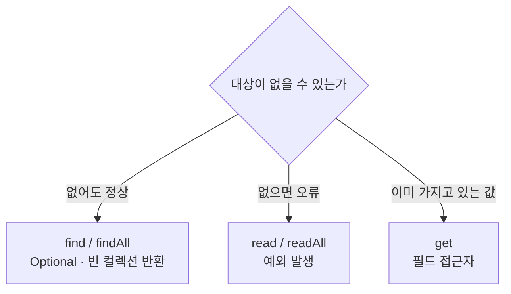

# 백엔드 네이밍 규칙

본 문서는 클래스·메서드 이름을 정하는 기준을 정의한다. 코드 리뷰의 판단 기준이 된다. 계층 구분은 [ARCHITECTURE.md](./ARCHITECTURE.md) 를 따른다.

- **호출부 한 줄만 읽어도 무슨 일이 일어나는지 알 수 있게 한다**
- 같은 개념에 같은 단어를 써서, 이름을 외우지 않아도 예측할 수 있게 한다
- 이름으로 계층을 드러내 의존 규칙 위반을 눈으로 잡는다

---

## 1. 원칙

### 1.1 `클래스.메서드()` 가 한 문장으로 읽혀야 한다

이름은 클래스 하나, 메서드 하나를 따로 정하지 않는다. **호출되는 형태 그대로** 정한다.

| 요소 | 문장에서의 역할 | 품사 |
| --- | --- | --- |
| 클래스 | 주어 — 무엇이 | 명사구 |
| 메서드 | 술어 — 무엇을 한다 | 동사구 |

```java
memberValidator.checkNotDuplicated(email);   // 회원 검증기가, 중복이 아님을 확인한다
memberWriter.append(command);                // 회원 기록기가, 추가한다
memberNotifier.sendWelcome(member);          // 회원 알림기가, 환영 메일을 보낸다
```

세 줄을 이어 읽으면 그대로 "회원 가입" 유스케이스가 된다. `Service` 를 읽는 사람이 각 클래스를 열어보지 않고도 흐름을 파악할 수 있다면 이름이 제 역할을 한 것이다.

### 1.2 이름을 확정하기 전 세 가지 검사

**(1) 소리내어 읽기** — 호출부를 한국어 문장으로 옮겼을 때 말이 되는가.

```java
// ❌ "회원 서비스가 회원 데이터를 처리한다" — 무슨 일이 일어나는지 알 수 없다
memberService.processMemberData(dto);

// ✅ "회원 서비스가 등록한다"
memberService.register(command);
```

**(2) 중복 검사** — 클래스가 이미 말한 것을 메서드가 반복하지 않는가.

```java
// ❌ Member 가 세 번 나온다
memberReader.readMember(memberId);

// ✅ 주어에 있는 것을 술어에서 뺀다
memberReader.read(memberId);
```

**(3) 구현 누출 검사** — 이름이 "어떻게" 가 아니라 "무엇을" 을 말하는가.

```java
// ❌ 캐시를 쓰는지는 호출자가 알 필요 없다. 구현이 바뀌면 이름도 바꿔야 한다
memberReader.readFromCacheOrDb(memberId);

// ✅
memberReader.read(memberId);
```

### 1.3 이름이 길어지는 것은 문제가 아니다

`MemberWithdrawManager` 는 `MemberManager` 보다 길지만, 짧은 쪽은 무엇을 관리하는지 말하지 않는다. 줄여야 할 것은 글자 수가 아니라 **읽는 사람이 코드를 열어봐야 하는 횟수**다.

다만 이름이 길어지는 이유가 클래스가 여러 일을 하기 때문이라면, 이름이 아니라 클래스를 나눈다.

---

## 2. 클래스 네이밍

### 2.1 공통 규칙

1. **명사 또는 명사구** — 동사로 시작하지 않는다 (`ValidateMember` ❌ → `MemberValidator` ✅)
2. **도메인이 맨 앞, 역할이 맨 뒤** — `MemberService`, `MemberReader` (2.2)
3. **역할 접미사를 반드시 붙인다** — 접미사가 계층을 드러낸다 (2.3)
4. **축약하지 않는다** — `MemReader` ❌, `MemberReader` ✅. 예외는 관례로 굳은 `id`, `url`, `api`, `db`, `dto` 뿐이다
5. **한 클래스는 한 역할** — 이름에 `And` 가 들어가면 클래스를 나눈다

### 2.2 도메인을 맨 앞에 둔다

모든 클래스 이름은 **도메인으로 시작해 역할로 끝난다.**

```
Member   +   Withdraw    +   Manager
도메인        유스케이스         역할
(필수)        (선택)           (필수)
```

| ✅ | ❌ | |
| --- | --- | --- |
| `MemberService` | `ServiceMember` | 역할이 앞에 왔다 |
| `MemberReader` | `ReadMember` | 동사로 시작한다 |
| `MemberController` | `Member` | 역할 접미사가 없다 |
| `MemberWithdrawManager` | `WithdrawManager` | 도메인이 없다 |

이 순서를 고정하는 이유는 네 가지다.

1. **도메인 단위로 묶인다** — 파일 목록이 도메인별로 정렬되고, 자동완성에서 `Member` 만 쳐도 그 도메인의 클래스가 전부 나온다
2. **주어가 먼저 온다** — 1.1 의 "클래스가 주어" 규칙과 같은 이유다. `memberReader.read(id)` 는 앞에서부터 읽으면 그대로 "회원을 읽는다" 가 된다
3. **접미사 자리가 고정된다** — 마지막 단어만 보고 역할과 계층을 판별할 수 있다 (2.3)
4. **도메인 없는 이름은 충돌한다** — `WithdrawManager` 는 회원 탈퇴인지 출금인지 알 수 없고, 도메인이 늘어나면 이름이 겹친다

가운데 유스케이스 자리는 **그것 없이는 구분되지 않을 때만** 넣는다. `Manager`, `Request`, `Response`, `Command` 가 여기에 해당한다.

### 2.3 계층별 역할 접미사

접미사만 보고 어느 계층인지 알 수 있어야 한다. 계층별 책임은 [ARCHITECTURE.md 2장](./ARCHITECTURE.md) 을 따른다.
아래 접미사는 자주 쓰는 **대표 어휘**이지, 모든 클래스를 이 목록에 맞추기 위한 고정 형식이 아니다.
같은 계층 안에서도 클래스의 실제 책임을 가장 정확하게 드러내는 역할명을 고른다.

| 계층 | 접미사 | 예시 | 의미 |
| --- | --- | --- | --- |
| `api` | `Controller` | `MemberController` | HTTP 엔드포인트 |
| | `Request` / `Response` | `MemberRegisterRequest` | 요청·응답 DTO |
| `domain` | `Service` | `MemberService` | 유스케이스 흐름 |
| | `Command` | `MemberRegisterCommand` | 계층 간 입력 값 |
| | (접미사 없음) | `Member`, `Block` | 도메인 모델 |
| `implementation` | `Reader` | `MemberReader` | 조회 |
| | `Writer` | `MemberWriter` | 저장·수정·삭제 |
| | `Validator` | `MemberValidator` | 검증 |
| | `Handler` | `PaymentWebhookHandler` | 이벤트·메시지·콜백처럼 정해진 입력을 받아 처리 |
| | `Manager` | `MemberWithdrawManager` | 여러 유스케이스에서 재사용하는 복합 단계 구현 |
| | `Notifier` / `Sender` | `MemberNotifier` | 외부 시스템 연동 |
| `storage` | `Entity` | `MemberEntity` | JPA 엔티티 |
| | `Repository` | `MemberRepository` | 저장소 접근 |

- **`Service` 는 도메인당 하나다.** 유스케이스는 클래스가 아니라 **메서드**로 표현한다. [ARCHITECTURE.md 2.2](./ARCHITECTURE.md) 의 "`Service` 의 메서드 하나가 유스케이스 하나에 대응한다" 를 그대로 따른 것이다

  ```java
  // ❌ 유스케이스마다 클래스를 만든다 — 도메인 하나에 파일이 계속 늘어난다
  memberRegisterService.register(command);
  memberWithdrawService.withdraw(memberId);

  // ✅ 도메인 하나에 Service 하나, 유스케이스는 메서드
  memberService.register(command);
  memberService.withdraw(memberId);
  ```

- **`Writer` 로 획일화하지 않는다.** 책임의 중심이 영속성 변경이면 `Writer` 가 어울리지만, 정해진 입력의 처리라면 `Handler` 가 더 정확하다. `Resolver`, `Assembler`, `Calculator`, `Converter` 등 다른 역할명이 실제 책임을 더 잘 설명한다면 사용할 수 있다
- **`Manager` 는 재사용하는 복합 단계에만 둔다.** 트랜잭션 위임만 하거나 유스케이스 전체를 대신 수행하는 클래스로 만들지 않는다 ([ARCHITECTURE.md 3.3](./ARCHITECTURE.md))
- **`Handler` 는 처리 대상과 계약이 분명할 때 쓴다.** 단지 여러 로직을 담기 편하다는 이유로 붙이지 않는다. `PaymentWebhookHandler` 처럼 무엇을 받는지 이름에서 드러나야 한다
- **엔티티에는 `Entity` 를 붙인다.** 도메인 모델 `Member` 와 엔티티 `MemberEntity` 가 이름으로 구분되어야, 엔티티가 `storage` 밖으로 새는 것이 리뷰에서 바로 보인다

### 2.4 쓰지 않는 이름

| 이름 | 문제 | 대안 |
| --- | --- | --- |
| `XxxUtil`, `XxxHelper` | 행동의 주체가 없다. 갈 곳 없는 코드가 모이는 창고가 된다 | 동작할 객체의 메서드로 옮기거나, 역할 이름을 붙인 클래스로 만든다 |
| `XxxInfo`, `XxxData`, `XxxVo` | 무엇을 담는지 말하지 않는다 | `MemberProfile`, `MemberRegisterCommand` 처럼 용도를 이름에 넣는다 |
| `XxxProcessor`, 대상이 불분명한 `XxxHandler` | 모든 코드가 무언가를 처리한다. 대상과 계약이 보이지 않으면 구분에 쓸모가 없다 | 실제 역할을 쓰거나 처리 대상을 밝힌다: `PaymentWebhookHandler` |
| `XxxManager` (범용) | 관리의 범위가 무한하다 | 2.3 의 정의대로 재사용하는 복합 단계에만 쓴다 |
| `XxxServiceImpl` | 구현이 하나뿐인데 인터페이스를 나눈 흔적. 이름이 아무 정보도 주지 않는다 | 구현이 하나면 인터페이스를 두지 않는다 |
| `Common`, `Base`, `AbstractXxx` (습관적) | 공통이라는 이유로 관련 없는 코드가 붙는다 | 실제로 공유하는 개념의 이름을 찾는다 |

---

## 3. 메서드 네이밍

### 3.1 동사로 시작한다

예외는 값을 그대로 돌려주는 record 의 접근자뿐이다.

```java
// ❌
public Member memberById(Long id) { ... }
public void registration(MemberRegisterCommand command) { ... }

// ✅
public Member read(Long id) { ... }
public Member register(MemberRegisterCommand command) { ... }
```

### 3.2 계층마다 동사 어휘를 다르게 쓴다

같은 "저장" 이라도 계층마다 다른 동사를 쓴다. 그래야 호출부 한 줄만 보고도 **어느 계층을 부르고 있는지** 드러나고, 계층 건너뛰기가 눈에 띈다.

| 계층 | 대표 동사 | 예시 |
| --- | --- | --- |
| `api` | HTTP 행위에 대응 | `register`, `get`, `modify`, `delete` |
| `domain` | **유스케이스 이름 그대로** | `register`, `withdraw`, `publish`, `settle` |
| `implementation` | `read`, `append`, `modify`, `remove`, `check`, `send` | `memberWriter.append(...)` |
| `storage` | Spring Data 규칙 | `findByEmail`, `existsByEmail`, `countBy`, `deleteBy` |

```java
memberWriter.append(command);        // implementation 을 부르고 있다
memberRepository.save(entity);       // Service 에서 이 줄이 보이면 계층 위반이다
```

### 3.3 조회 동사는 "없을 때" 로 구분한다



| 동사 | 대상이 없을 때 | 주 사용처 |
| --- | --- | --- |
| `find` | `Optional` 또는 빈 컬렉션 | `storage` |
| `read` | 예외 (`NotFoundException`) | `implementation` |
| `get` | 해당 없음 (이미 존재하는 값의 접근자) | 전 계층 |

`get` 을 조회 전반에 쓰지 않는다. `getMember(id)` 는 값이 없을 때 어떻게 되는지 말해주지 않아, 호출부마다 구현을 열어보게 만든다.

### 3.4 boolean 은 `is` / `has` / `can` / `exists`

```java
// ✅
public boolean isActive() { ... }
public boolean hasPermission(Permission permission) { ... }
public boolean existsByEmail(String email) { ... }

// ❌ 부정형은 호출부에서 이중 부정이 된다
if (!member.isNotActive()) { ... }
```

검증에서 **실패 시 예외를 던지는** 메서드는 `check` 로 시작하고 `void` 를 반환한다. 판단만 하는 `is` 와 역할이 다르므로 이름으로 구분한다.

```java
memberValidator.checkNotDuplicated(email);     // 실패하면 예외
if (memberValidator.isDuplicated(email)) { }   // 판단만 하고 흐름은 호출부가 결정
```

### 3.5 변환 메서드

| 형태 | 규칙 | 예시 |
| --- | --- | --- |
| 정적 팩토리 (타입 변환) | `from` | `MemberEntity.from(command)` |
| 정적 팩토리 (여러 인자 조합) | `of` | `Period.of(start, end)` |
| 인스턴스 → 다른 타입 | `toXxx` | `memberEntity.toDomain()` |

`new` 를 직접 노출하는 대신 정적 팩토리를 쓰면, 생성자 인자만으로는 알 수 없던 **생성 의도**가 이름에 남는다.

### 3.6 쓰지 않는 메서드 이름

| 이름 | 문제 |
| --- | --- |
| `doXxx`, `processXxx`, `executeXxx` | 무엇을 하는지 말하지 않는다 |
| 문맥 없는 `handleXxx` | 무엇을 처리하는지 말하지 않는다. 다만 대상이 클래스명에 명확한 `paymentWebhookHandler.handle(payload)` 같은 형태는 허용한다 |
| `xxxAndYyy` | 한 메서드가 두 가지 일을 한다는 자백이다. 나눈다 |
| `getXxxList` | 반환 타입에 이미 있는 정보다. 복수형이나 `readAll` 로 충분하다 |
| `xxx2`, `xxxNew`, `xxxV2` | 이전 것과 무엇이 다른지가 이름에 없다 |
| `init`, `setup` (public) | 객체가 생성 후 준비 단계를 요구한다는 뜻이다. 생성자나 정적 팩토리에서 끝낸다 |

---

## 4. 어휘 사전

**하나의 개념에는 프로젝트 전체에서 하나의 단어만 쓴다.** `create` 와 `add` 와 `append` 가 섞여 있으면, 읽는 사람은 셋이 다른 일을 한다고 가정하고 구현을 확인하게 된다.

### 4.1 표준 어휘

| 개념 | 사용 | 쓰지 않음 |
| --- | --- | --- |
| 단건 조회 (없으면 예외) | `read` | `get`, `fetch`, `retrieve`, `select` |
| 단건 조회 (없어도 정상) | `find` | `search`, `lookup` |
| 다건 조회 | `readAll` / `findAll` | `list`, `getAll` |
| 조건 검색 | `search` | `query`, `filter` |
| 생성·저장 | `append` (implementation) / `save` (storage) | `insert`, `put`, `regist` |
| 수정 | `modify` | `update`, `change`, `edit` 혼용 |
| 삭제 | `remove` | `delete`, `erase` 혼용 |
| 검증 (실패 시 예외) | `check` | `validate`, `verify`, `assert` 혼용 |
| 외부 발송 | `send` | `publish`, `notify` 혼용 |

> `regist` 는 영어에 없는 단어다. `register` 를 쓴다.

### 4.2 반대말은 짝을 맞춘다

한쪽만 정하고 반대쪽을 즉흥적으로 지으면 대칭이 깨진다.

| | |
| --- | --- |
| `create` ↔ `delete` | `add` ↔ `remove` |
| `open` ↔ `close` | `start` ↔ `stop` |
| `register` ↔ `withdraw` | `activate` ↔ `deactivate` |
| `enable` ↔ `disable` | `acquire` ↔ `release` |

### 4.3 도메인 용어는 번역하지 않는다

기획·DB·코드가 같은 단어를 써야 한다. 회의에서 "블록" 이라 부르는 것을 코드에서 `Chunk` 로 부르면, 그때부터 두 용어를 머릿속에서 매핑하며 읽어야 한다.

새 도메인 용어가 등장하면 코드에 쓰기 전에 팀에서 단어를 정하고, 4.1 에 추가한다.

---

## 5. 그 외 이름

### 5.1 변수·필드

- 필드 이름은 타입의 lowerCamelCase 를 기본으로 한다 (`MemberReader memberReader`)
- 축약하지 않는다: `req` → `request`, `cnt` → `count`, `tmp` → 실제 의미
- 한 글자 이름은 람다·반복문의 지역 변수까지만 허용한다
- 컬렉션은 복수형으로 쓴다 (`members`). `memberList` 처럼 타입을 이름에 넣지 않는다
- boolean 필드는 3.4 를 따른다 (`active`, `deleted`)

### 5.2 DTO

| 위치 | 접미사 | 방향 |
| --- | --- | --- |
| `api` 입력 | `Request` | 클라이언트 → 서버 |
| `api` 출력 | `Response` | 서버 → 클라이언트 |
| `api` → `domain` | `Command` | 유스케이스 입력 |

이름은 `도메인 + 유스케이스 + 접미사` 로 짓는다: `MemberRegisterRequest`, `MemberRegisterCommand`, `MemberRegisterResponse`. 하나의 DTO 를 여러 유스케이스가 공유하기 시작하면 필드가 계속 늘어나므로, 유스케이스마다 따로 만든다.

### 5.3 패키지

- 전부 소문자, 복수형·언더스코어를 쓰지 않는다 (`com.aiblockclock.member`)
- 계층 패키지 이름은 [ARCHITECTURE.md 5장](./ARCHITECTURE.md) 의 표를 따른다

### 5.4 테스트

테스트 메서드 이름은 **한글로 쓰고**, 검증 대상을 문장으로 적는다. 실패했을 때 리포트에 뜨는 문장이 그대로 원인 설명이 되어야 한다.

```java
@Test
void 이미_가입된_이메일이면_예외가_발생한다() { ... }

@Test
void 가입에_성공하면_환영_메일이_발송된다() { ... }
```

---

## 6. 유스케이스 하나로 보는 전체 예시

"회원 가입" 하나에 등장하는 이름들이다. 계층을 몰라도 이름만으로 흐름이 읽히는지 확인한다.

```java
// api
MemberController.register(MemberRegisterRequest request)

// domain
MemberService.register(MemberRegisterCommand command)

// implementation
MemberValidator.checkNotDuplicated(String email)
MemberWriter.append(MemberRegisterCommand command)
MemberNotifier.sendWelcome(Member member)

// storage
MemberRepository.existsByEmail(String email)
MemberRepository.save(MemberEntity entity)
MemberEntity.from(MemberRegisterCommand command)
MemberEntity.toDomain()
```

```java
@Service
@RequiredArgsConstructor
public class MemberService {

    private final MemberValidator memberValidator;
    private final MemberWriter memberWriter;
    private final MemberNotifier memberNotifier;
    private final MemberWithdrawManager memberWithdrawManager;

    public Member register(MemberRegisterCommand command) {
        memberValidator.checkNotDuplicated(command.email());
        Member member = memberWriter.append(command);
        memberNotifier.sendWelcome(member);
        return member;
    }

    public void withdraw(Long memberId) {
        memberWithdrawManager.withdraw(memberId);
    }
}
```

클래스는 `Member` 로 시작하고, 유스케이스는 `register` · `withdraw` 라는 메서드로 나뉜다. 본문에 주석이 필요하지 않다면 이름이 제 역할을 다한 것이다.

---

## 7. 리뷰 체크리스트

- [ ] 호출부 `클래스.메서드()` 가 한 문장으로 읽히는가
- [ ] 클래스가 이미 말한 단어를 메서드가 반복하고 있지 않은가
- [ ] 이름이 "무엇을" 이 아니라 "어떻게" 를 말하고 있지 않은가
- [ ] 클래스 이름이 도메인으로 시작하는가
- [ ] 클래스에 계층을 드러내는 역할 접미사가 붙어 있는가
- [ ] `Util`, `Helper`, `Info`, `Handler`, `ServiceImpl` 이 새로 생기지 않았는가
- [ ] 유스케이스를 클래스가 아니라 메서드로 표현했는가 (`MemberService.register`)
- [ ] 조회 메서드가 `find` / `read` / `get` 중 맞는 것을 쓰고 있는가
- [ ] 이름에 `And` 가 들어간 클래스·메서드가 없는가
- [ ] 4장 어휘 사전에 없는 동사를 새로 만들지 않았는가 (필요하면 문서에 추가)
- [ ] 축약어를 쓰지 않았는가
