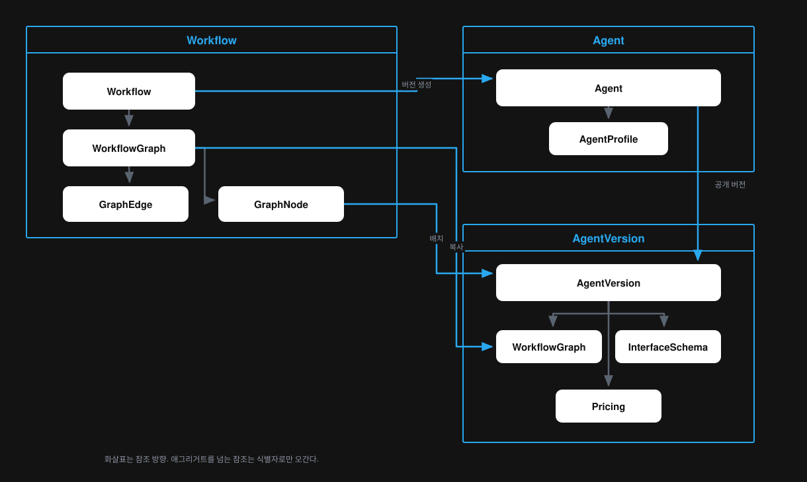

# 도메인 모델

애그리거트 셋과 그 안의 1급 개념, 그리고 애그리거트 사이의 관계.

## 애그리거트

| 애그리거트 | 무엇인가 | 안에 있는 것 |
| --- | --- | --- |
| **Workflow** | 사용자가 캔버스에 그리는, 편집 가능한 그래프 | `WorkflowGraph` · `GraphNode` · `GraphEdge` |
| **Agent** | 마켓에서 유통되는 거래 단위의 **정체성** | `AgentProfile` |
| **AgentVersion** | 한 번 확정되면 바뀌지 않는 **실행 정의** | `WorkflowGraph`(스냅샷) · `VersionCost` · `Tier` |

`Agent` 와 `AgentVersion` 이 따로인 이유는, 이름과 소개는 바뀌어도 같은 에이전트지만 내부 그래프를
바꾸면 다른 실행 정의이기 때문이다. 이전 것을 덮어쓰면 남이 그려 둔 워크플로우가 깨진다(AGT-009).

## 애그리거트 사이

| 관계 | 무엇이 오가는가 |
| --- | --- |
| `Workflow` → `Agent` **버전 생성** | 검증을 통과한 워크플로우의 그래프를 복사해 `AgentVersion` 을 만든다. 처음이면 `Agent` 도 함께 생긴다 |
| `Agent` → `AgentVersion` **공개 버전** | `PublicVersion` — 공개된 버전의 식별자와 번호 하나 |
| `GraphNode` → `AgentVersion` **배치** | `AgentId` + `AgentVersionId`. 버전까지 고정한다 |
| `WorkflowGraph` → `WorkflowGraph` **복사** | 버전 생성 시점의 그래프를 값으로 복사한다 |

**애그리거트를 넘는 참조는 전부 식별자다.** 객체를 직접 물고 있지 않으므로, 한쪽을 고쳐도 다른 쪽의
저장 단위가 딸려 오지 않는다.

## 그림에서 읽어야 할 두 가지

**`WorkflowGraph` 가 두 번 나온다.** 같은 타입이지만 서로 다른 값이다. 버전 생성 시점에 복사되고,
이후 원본 워크플로우를 아무리 고쳐도 `AgentVersion` 쪽 그래프는 그대로다. 값 객체라 복사가
참조를 넘기는 것으로 끝난다.

**배치는 `Agent` 가 아니라 `AgentVersion` 을 가리킨다.** 원작자가 새 버전을 올려도 이미 그려둔
워크플로우가 다른 정의로 실행되지 않게 하기 위해서다. `Agent` 의 공개 버전 포인터는 **새로
배치할 때만** 쓰인다. 아직 공개되지 않은 버전은 포인터가 아니라 조회로 찾는다 — 소유자가
자기 것을 보는 일에는 지킬 불변식이 없기 때문이다.

## 그림에 없는 것

- `NodeKey` · `EdgeKey` · `NodeReference` · `Revision` · `PublicVersion` · `AbcAmount` 같은 딸린 값
- `NodeType` · `ValidationStatus` · `Tier` 같은 enum
- `AgentVersionPolicy` · `GraphLimits` 같은 정책 객체

1급 개념만 남겼다. 나머지는 코드와 [`RULE.md`](../RULE.md) 를 본다.
